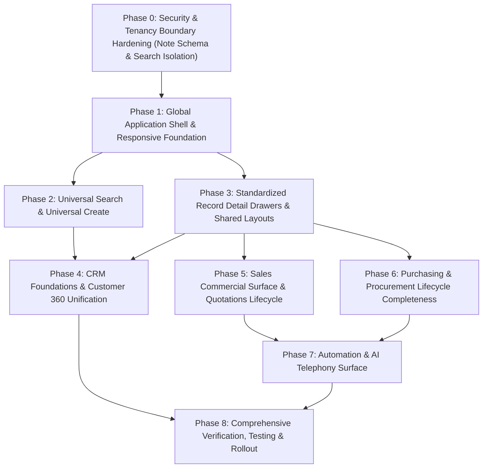

# NIWA: Unified UX Implementation & Dependency Plan

**Status:** Authoritative Engineering Implementation Plan  
**Target Branch:** `main` (Implementation to occur on feature branches after audit approval)  
**Documentation Branch:** `docs/unified-ux-navigation-spec`  
**Frontend Commit Baseline:** [`a08a3eefe7ff726e0f10314486d42bf465fbe4c6`](https://github.com/Easesmith-IT/NiWa-frontend/commit/a08a3eefe7ff726e0f10314486d42bf465fbe4c6)  
**Backend Commit Baseline:** [`925238622f676b7db010373ab25114dc7448ebf5`](https://github.com/Easesmith-IT/NiWa-backend/commit/925238622f676b7db010373ab25114dc7448ebf5)  
**Specification Reference:** `docs/NIWA-UNIFIED-UX-NAVIGATION-SPEC.md`  

---

## 1. Principles & Architectural Constraints

1. **Dependency Order Over Arbitrary Slices:** Every phase builds strictly upon the verified contracts and capabilities established in prior phases. This is not a proposal to cut scope or split into V1/V2 feature subsets; it is the exact technical execution order required to deliver the complete, coherent NIWA experience.
2. **Single Workspace Tenancy:** NIWA operates on a single customer workspace per tenant account. Global configuration and module entitlements are managed by workspace administrators, while user access is governed by roles (`owner`, `admin`, `member`, `viewer`) and fine-grained permissions.
3. **No Unbacked Claims:** Frontend surfaces are created only against verified backend API contracts and database schemas. Missing backend capabilities identified in the audit (such as PO-to-bill bridging or multi-entity search) must be implemented with integration tests before frontend wiring.
4. **Communication / WhatsApp Guardrail:** The existing WhatsApp conversation and real-time messaging pipeline must remain intact. Changes in the communication domain are strictly limited to the right-hand context drawer (`InboxContactSidebar`) for CRM linking and deal creation.
5. **No Visual Novelty for its Own Sake:** All UI changes must directly solve identified usability defects, missing workflows, or context-loss issues identified in the audit.
6. **Explicit Scope Exclusion (Email Automation):** Email automation is formally classified as **UNIMPLEMENTED / FUTURE ARCHITECTURE DEPENDENCY** and is excluded from all active implementation commitments.

---

## 2. Dependency Graph & Phase Overview

---

## 3. Phase-by-Phase Technical Specifications

### Phase 0: Security & Tenancy Boundary Hardening (P0)

#### Objective
Eliminate cross-workspace data leakage in global search and verify strict tenant isolation across all backend query pipelines.

#### Tasks:
1. **Note Model Tenancy Partitioning:**
   - In [`NiWa-backend/src/models/note.model.ts`](https://github.com/Easesmith-IT/NiWa-backend/blob/925238622f676b7db010373ab25114dc7448ebf5/src/models/note.model.ts): Add `workspaceId: { required: true, type: String, index: true }` to `noteSchema`.
   - In [`NiWa-backend/src/modules/notes/notes.service.ts`](https://github.com/Easesmith-IT/NiWa-backend/blob/925238622f676b7db010373ab25114dc7448ebf5/src/modules/notes/notes.service.ts): Update `createNote` to assign `workspaceId` from the active context or contact.
   - This automatically enables `workspaceIsolationPlugin` pre-hooks on all `NoteModel` operations (`find`, `findOne`, `countDocuments`).
2. **Backend Search Scoping Hardening:**
   - In [`NiWa-backend/src/modules/search/search.controller.ts`](https://github.com/Easesmith-IT/NiWa-backend/blob/925238622f676b7db010373ab25114dc7448ebf5/src/modules/search/search.controller.ts): Explicitly pass `req.workspaceId!` to `runGlobalSearch`.
   - In [`NiWa-backend/src/modules/search/search.service.ts`](https://github.com/Easesmith-IT/NiWa-backend/blob/925238622f676b7db010373ab25114dc7448ebf5/src/modules/search/search.service.ts): Ensure queries against `ContactModel`, `ConversationModel`, `MessageModel`, and `NoteModel` explicitly incorporate `{ workspaceId }`.
3. **Backend Automated Isolation Regression Tests:**
   - Add automated test in `src/tests/workspace-isolation.test.ts` verifying that `NoteModel.find` throws when context is missing, and isolates notes strictly between Tenant A and Tenant B during search.

#### Deliverables & Verification:
- Modified files: `NiWa-backend/src/models/note.model.ts`, `src/modules/notes/notes.service.ts`, `src/modules/search/search.controller.ts`, `src/modules/search/search.service.ts`.
- Test command: `node --import tsx --test src/tests/workspace-isolation.test.ts` (100% pass).

---

### Phase 1: Global Application Shell & Responsive Foundation (P0 & P1)

#### Objective
Deliver a responsive, mobile-accessible application shell, dynamic module entitlement filtering in navigation, hierarchical breadcrumbs, and standardized error/module-disabled boundaries.

#### Tasks:
1. **Responsive Mobile Navigation (P0 Defect Resolution):**
   - In `components/layout/`, create `mobile-nav.tsx` using a Radix UI Sheet / Dialog primitive.
   - Update [`components/layout/app-shell.tsx`](https://github.com/Easesmith-IT/NiWa-frontend/blob/a08a3eefe7ff726e0f10314486d42bf465fbe4c6/components/layout/app-shell.tsx): Manage `mobileNavOpen` state distinctly from desktop `sidebarCollapsed`.
   - Update [`components/layout/topbar.tsx`](https://github.com/Easesmith-IT/NiWa-frontend/blob/a08a3eefe7ff726e0f10314486d42bf465fbe4c6/components/layout/topbar.tsx): The hamburger button (`Menu`) toggles `mobileNavOpen`, with proper `aria-expanded` and `aria-controls`.
   - In `mobile-nav.tsx`: Render `navigationGroups` filtered by enabled modules. Auto-close sheet when Next.js `pathname` changes. Trap focus and support Escape to close.
2. **Dynamic Sidebar Entitlement Filtering (P1):**
   - Update [`lib/workspace/workspace-context.tsx`](https://github.com/Easesmith-IT/NiWa-frontend/blob/a08a3eefe7ff726e0f10314486d42bf465fbe4c6/lib/workspace/workspace-context.tsx): Add `enabledModules: string[]` to `WorkspaceContext`. Query `/api/modules` on session load.
   - Update [`components/layout/sidebar.tsx`](https://github.com/Easesmith-IT/NiWa-frontend/blob/a08a3eefe7ff726e0f10314486d42bf465fbe4c6/components/layout/sidebar.tsx): Replace direct `navigationGroups.map(...)` with `filterNavigationByModules(navigationGroups, enabledModules).map(...)`.
   - Update [`components/layout/navigation.ts`](https://github.com/Easesmith-IT/NiWa-frontend/blob/a08a3eefe7ff726e0f10314486d42bf465fbe4c6/components/layout/navigation.ts): Add `moduleKey: "crm"` to the CRM navigation group.
3. **Breadcrumbs & Contextual Headers:**
   - Create `components/layout/breadcrumbs.tsx` parsing route segments with human-readable labels (e.g. `/products/66d1...` -> `Products > Widget Pro`).
   - Remove hardcoded static "API Live" wifi pill from `topbar.tsx`. Replace with real WebSocket connection indicator or remove.
4. **Module-Disabled & Access-Denied Boundaries:**
   - Create `components/shared/module-disabled-card.tsx` and `permission-denied-card.tsx`.
   - Wrap feature page layouts with an error boundary or entitlement check: If a module is disabled, display a clean card: *"This module is currently disabled for your workspace. Please contact your administrator."*

#### Deliverables & Verification:
- Modified files: `NiWa-frontend/components/layout/app-shell.tsx`, `sidebar.tsx`, `topbar.tsx`, `navigation.ts`, `lib/workspace/workspace-context.tsx`.
- New components: `mobile-nav.tsx`, `breadcrumbs.tsx`, `module-disabled-card.tsx`.
- Vitest tests: `lib/navigation/navigation.test.ts`, `components/layout/mobile-nav.test.ts`.

---

### Phase 2: Universal Search & Universal Create (P1)

#### Objective
Transform the Command Palette into a comprehensive discovery and quick-creation engine across all core business entities.

#### Tasks:
1. **Universal Search Backend Expansion:**
   - Extend [`src/modules/search/search.service.ts`](https://github.com/Easesmith-IT/NiWa-backend/blob/925238622f676b7db010373ab25114dc7448ebf5/src/modules/search/search.service.ts) to query `PersonModel`, `CompanyModel`, `DealModel`, `ProductModel`, `SalesOrderModel`, and `PurchaseOrderModel` (with limit 5 per entity and indexed regex matching on title, SKU, orderId, name).
   - Format response with grouped arrays: `contacts`, `conversations`, `people`, `companies`, `deals`, `products`, `salesOrders`, `purchaseOrders`.
2. **Universal Search Frontend Wiring:**
   - Update [`features/search/search.types.ts`](https://github.com/Easesmith-IT/NiWa-frontend/blob/a08a3eefe7ff726e0f10314486d42bf465fbe4c6/features/search/search.types.ts) to mirror the extended backend response.
   - Update [`CommandPalette.tsx`](https://github.com/Easesmith-IT/NiWa-frontend/blob/a08a3eefe7ff726e0f10314486d42bf465fbe4c6/components/layout/command-palette.tsx): Render categorized search result groups with entity-specific icons and contextual subtitles.
   - Fix navigation destinations:
     - Contact -> `/inbox?conversationId=${c.conversationId}` or `/contacts?id=${c._id}`
     - Person -> `/people?id=${p._id}`
     - Deal -> `/deals?id=${d._id}`
     - Product -> `/products/${p._id}`
     - Sales Order -> `/sales/orders?id=${o._id}`
3. **Universal Create Modal / Drawer:**
   - Create `components/layout/universal-create-modal.tsx` with clear, searchable action tiles:
     - *New Customer / Person* (opens Person quick form)
     - *New Deal* (opens Deal form)
     - *New Sale / Order* (navigates to `/sales/orders` with create modal open)
     - *New Product* (opens product quick creation)
     - *New Task* (opens Task quick creation with combobox linked records)
     - *New Purchase Order* (opens PO form)
   - Add a prominent `+ Create` primary button to `topbar.tsx` and a keyboard shortcut (`C` or `Alt+C`).

#### Deliverables & Verification:
- Modified: `NiWa-backend/src/modules/search/search.service.ts`, `search.dto.ts`.
- Modified: `NiWa-frontend/components/layout/command-palette.tsx`, `topbar.tsx`.
- New: `universal-create-modal.tsx`.
- Tests: `search-multi-entity.test.ts`, `universal-create.test.ts`.

---

### Phase 3: Standardized Record Detail Drawers & Shared Layouts (P2)

#### Objective
Eliminate redundant, copy-pasted drawer code across People, Companies, Deals, and Orders by creating a unified, accessible slideover drawer standard.

#### Tasks:
1. **Shared Slideover Drawer Primitive:**
   - Create `components/ui/record-drawer.tsx` wrapping Radix UI Dialog / Sheet with:
     - Accessible title, description, and close button.
     - Consistent width: `max-w-xl` on desktop, `w-full` on mobile.
     - Standardized header containing avatar/icon, record title, status badge, and primary action menu.
     - Tabs for Overview, Timeline/Activity, Linked Records, Notes.
2. **Standardized Activity Timeline Component:**
   - Create `components/shared/activity-timeline.tsx` capable of rendering calls, WhatsApp messages, status changes, notes, and task completions in chronological order.
3. **Refactor Existing Drawers:**
   - Refactor `PersonDetailDrawer` in `people/page.tsx` and `CompanyDetailDrawer` in `companies/page.tsx` to use `RecordDrawer`.

#### Deliverables & Verification:
- New: `components/ui/record-drawer.tsx`, `components/shared/activity-timeline.tsx`.
- Refactored: `app/(app)/people/page.tsx`, `app/(app)/companies/page.tsx`.
- Vitest tests: `record-drawer.test.ts`, `activity-timeline.test.ts`.

---

### Phase 4: CRM Foundations & Customer 360 Unification (P1)

#### Objective
Connect frontend record drawers to the verified backend Customer 360 engine, deliver a Deals detail view, create the `/leads` management page, fix the Task ObjectId selector, and allow linking contacts to CRM from inside the Inbox.

#### Tasks:
1. **Customer 360 Frontend Wiring:**
   - Create `features/crm/customer-360.api.ts` and `useCustomer360Query(recordType, recordId)`.
   - Embed Customer 360 sections into `PersonDetailDrawer` and `CompanyDetailDrawer`:
     - Deals summary card (open value, win rate, linked deal list).
     - Open tasks with one-click completion.
     - Activity timeline and communication statistics.
2. **Deals Detail View:**
   - Build `features/deals/components/DealDetailDrawer.tsx` using `RecordDrawer`.
   - Provide stage transition stepper, participant contacts list, deal value editor, and linked quotations/sales orders.
   - Wire clicking any deal card in `DealBoardView.tsx` or row in `DealListView.tsx` to open `DealDetailDrawer`.
3. **Leads Management Surface:**
   - Create `app/(app)/leads/page.tsx` with Leads table, status filters (New, Contacted, Qualified, Lost), and quick creation modal.
   - Wire the "Convert to Deal" button to backend `POST /api/crm/leads/:id/convert`.
   - Add "Leads" under the "CRM" group in `navigation.ts`.
4. **Task Linked Record Combobox:**
   - In [`features/tasks/components/LinkedRecordSelector.tsx`](https://github.com/Easesmith-IT/NiWa-frontend/blob/a08a3eefe7ff726e0f10314486d42bf465fbe4c6/features/tasks/components/LinkedRecordSelector.tsx): Replace raw text input with a searchable Combobox querying `/api/crm/people`, `/api/crm/companies`, and `/api/crm/deals`. Display name/title instead of hexadecimal IDs.
5. **Inbox ↔ CRM Contact Linking:**
   - In [`features/inbox/components/ContactProfileSection.tsx`](https://github.com/Easesmith-IT/NiWa-frontend/blob/a08a3eefe7ff726e0f10314486d42bf465fbe4c6/features/inbox/components/ContactProfileSection.tsx): Add "Link to CRM Person" typeahead and "+ Create Person from Contact" button.
   - When linked, store `contact.personId` via `POST /api/contacts/:id/link-person`, immediately unlocking Deals and Tasks inside `InboxContactSidebar`.

#### Deliverables & Verification:
- New: `app/(app)/leads/page.tsx`, `features/deals/components/DealDetailDrawer.tsx`.
- Modified: `features/tasks/components/LinkedRecordSelector.tsx`, `features/inbox/components/ContactProfileSection.tsx`, `InboxContactSidebar.tsx`.
- Tests: `customer-360.test.ts`, `deal-detail.test.ts`, `leads-page.test.ts`.

---

### Phase 5: Sales Commercial Surface & Quotations Lifecycle (P1)

#### Objective
Surface the existing backend Quotations engine in the UI, enable quote-to-order conversion, and provide customer refunds handling for sales returns.

#### Tasks:
1. **Quotations UI:**
   - Create `app/(app)/sales/quotes/page.tsx` with Quote table, status filters (Draft, Sent, Accepted, Declined, Expired).
   - Build `QuoteFormModal.tsx` for creating and editing quotes with product search, customer selection, and pricing.
   - Implement "Send Quote", "Accept Quote", and "Convert to Sales Order" (`POST /api/orders/convert-quote/:quoteId`).
   - Add "Quotations" under Sales in `navigation.ts`.
2. **Customer Refunds UI:**
   - In [`app/(app)/sales/returns/page.tsx`](https://github.com/Easesmith-IT/NiWa-frontend/blob/a08a3eefe7ff726e0f10314486d42bf465fbe4c6/app/%28app%29/sales/returns/page.tsx): For any Return in `RECEIVED` status, add an "Issue Customer Refund" action button.
   - Build `RefundModal.tsx` capturing refund amount, payment method (Bank, Cash, Credit Note), refund account, and reason. Submits to backend `POST /api/refunds`.

#### Deliverables & Verification:
- New: `app/(app)/sales/quotes/page.tsx`, `features/sales/components/QuoteFormModal.tsx`, `features/sales/components/RefundModal.tsx`.
- Modified: `app/(app)/sales/returns/page.tsx`, `navigation.ts`.
- Tests: `quotes-view.test.ts`, `refund-modal.test.ts`.

---

### Phase 6: Purchasing & Procurement Lifecycle Completeness (P1 & P2)

#### Objective
Bridge goods receipt directly into Supplier Bill creation in Finance with 3-way matching and duplicate prevention, and deliver the Purchase Returns UI.

#### Tasks:
1. **Goods Receipt → Draft Supplier Bill Bridge:**
   - In [`NiWa-backend/src/modules/purchasing/purchasing.service.ts`](https://github.com/Easesmith-IT/NiWa-backend/blob/925238622f676b7db010373ab25114dc7448ebf5/src/modules/purchasing/purchasing.service.ts): Add `createDraftBillFromPurchaseOrder(workspaceId, poId, input)`:
     - Pre-fills supplier, received line items, and ordered unit prices.
     - Creates a `SupplierBill` in status `DRAFT`.
     - Tracks `billedQuantity` against PO lines to prevent duplicate billing beyond received amounts.
   - In [`app/(app)/purchasing/orders/[id]/page.tsx`](https://github.com/Easesmith-IT/NiWa-frontend/blob/a08a3eefe7ff726e0f10314486d42bf465fbe4c6/app/%28app%29/purchasing/orders/%5Bid%5D/page.tsx): For any PO in `RECEIVED` or `PARTIALLY_RECEIVED` status with unbilled quantities, render a primary action: *"Create Draft Supplier Bill"*.
   - On click, navigate to `/finance/payables` with the draft bill open for variance review and confirmation.
2. **Purchase Returns UI:**
   - Create `app/(app)/purchasing/returns/page.tsx` displaying purchase return history, items returned, and supplier debit note status.
   - Build `CreatePurchaseReturnModal.tsx` allowing users to select a received PO, choose return lines and quantities, and record the return via `POST /api/purchasing/returns`.
   - Add "Purchase Returns" under Purchasing in `navigation.ts`.

#### Deliverables & Verification:
- Backend: `NiWa-backend/src/modules/purchasing/purchasing.routes.ts`, `purchasing.service.ts`.
- Frontend: `app/(app)/purchasing/returns/page.tsx`, `app/(app)/purchasing/orders/[id]/page.tsx`, `navigation.ts`.
- Tests: `po-bill-bridge.test.ts`, `purchase-returns.test.ts`.

---

### Phase 7: Automation & AI Telephony Surface (P2 & P3)

#### Objective
Expose the verified backend AI Calling capability in the frontend, refine the Automation builder into plain-language terminology, and formally correct specification claims regarding email automation.

#### Tasks:
1. **AI Calling Frontend Surface:**
   - Create `app/(app)/ai-calling/page.tsx` displaying:
     - Call logs table (Caller, Callee, Duration, Status, Outcome, Timestamp).
     - Call Detail drawer with embedded audio recording playback, structured transcript, and extracted CRM follow-ups.
     - Outbound Call modal to initiate calls to contacts.
   - In `app/(app)/people/page.tsx` and `InboxContactSidebar.tsx`: Add a "Call via AI" quick action.
   - Add "AI Calling" under Automate in `navigation.ts` (guarded by `ai_calling` moduleKey).
2. **Plain-Language Automation Builder Copy:**
   - Update `app/(app)/automations/page.tsx`: Replace raw technical strings (`incoming_message`, `create_task`) with plain language labels: *"When an incoming message arrives"*, *"Check these conditions"*, *"Then create a follow-up task"*.
3. **Email Automation Specification Correction:**
   - Verify `NIWA-UNIFIED-UX-NAVIGATION-SPEC.md` classifies Email Automation as "UNIMPLEMENTED / FUTURE ARCHITECTURE DEPENDENCY". Ensure zero phantom email options are rendered in the UI.

#### Deliverables & Verification:
- New: `app/(app)/ai-calling/page.tsx`, `features/ai-calling/`.
- Modified: `app/(app)/automations/page.tsx`, `navigation.ts`.
- Tests: `ai-calling-ui.test.ts`.

---

### Phase 8: Verification, Testing & Rollout Strategy

#### Objective
Execute comprehensive regression testing, unit testing, and end-to-end journey validation before promoting to main.

#### Verification Strategy:
1. **Non-Destructive Continuous Checks:**
   - Frontend: `npm run typecheck` and `npm run test` (Vitest) must pass with 0 errors after each phase.
   - Backend: `npm run typecheck` and `node --import tsx --test src/**/*.test.ts` must pass.
2. **Playwright E2E Verification Suite:**
   - Add Playwright E2E tests covering the 10 core business journeys:
     - `tests/e2e/journey-1-inbox-to-crm.spec.ts`
     - `tests/e2e/journey-2-quote-to-payment.spec.ts`
     - `tests/e2e/journey-3-po-to-bill.spec.ts`
     - `tests/e2e/journey-8-universal-search.spec.ts`
     - `tests/e2e/journey-10-module-guards.spec.ts`
3. **Rollout Verification Standard:**
   - Features released behind module enablement flags in `WorkspaceModuleModel`.
   - Core shell and responsive fixes apply globally with zero disruption to desktop workflows.
